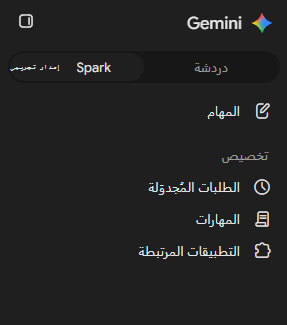
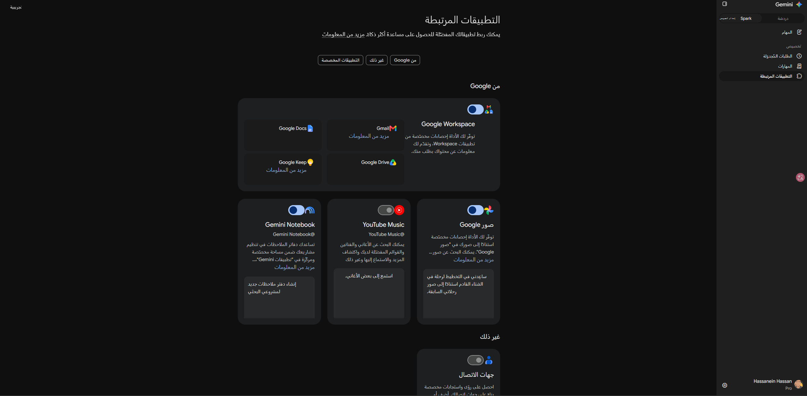
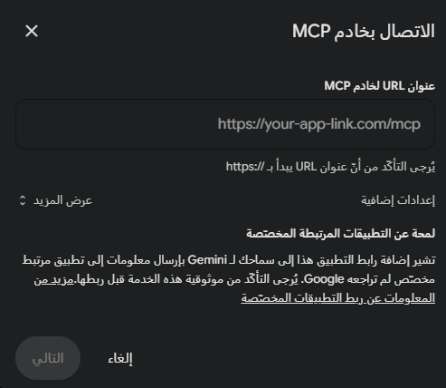
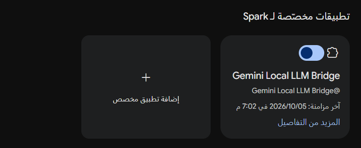
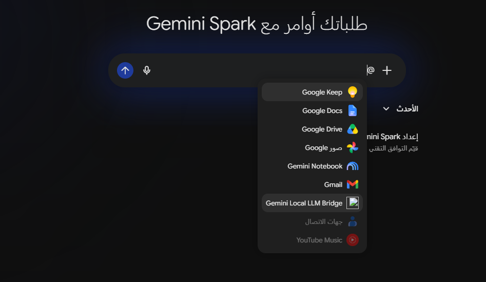
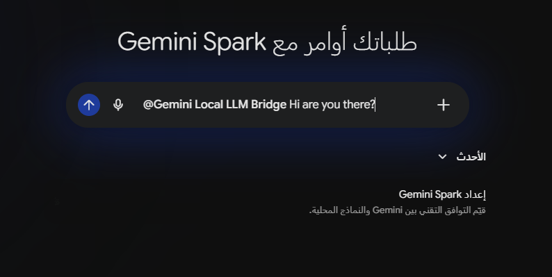

# Visual Step-by-Step Setup Guide: Connecting Gemini to Local LLM via MCP

This visual guide documents the 6 exact steps to configure, activate, and communicate with the **Gemini Local LLM Bridge** in the **Google Gemini (Personalization / Connected Apps)** interface.

---

## Step 1: Open Connected Apps
From the Gemini sidebar:
1. Navigate to the **Personalization** section.
2. Click on **Connected Apps**.



---

## Step 2: Navigate to Custom Apps
Inside the Connected Apps dashboard:
1. Click the **Custom Apps** tab (or **Other**).
2. Click **Add Custom App** (or the `+` button).



---

## Step 3: Enter the MCP Server Endpoint
In the popup dialog titled **"Connect to MCP Server"**:
1. In the **MCP Server URL** field, enter your public tunnel endpoint (must start with `https://` and end with `/mcp`):
   ```text
   https://<your-subdomain>.trycloudflare.com/mcp
   ```
2. *(Optional)* If you set `AUTH_TOKEN` in `.env`, click **Show more** and provide your Bearer token.
3. Click **Next / Save**.



---

## Step 4: Verify App Activation & Mention Tag
After connecting successfully:
- A card named **Gemini Local LLM Bridge** will appear.
- Ensure the toggle switch is turned **ON**.
- Notice the explicit mention handle: `@Gemini Local LLM Bridge`.



---

## Step 5: Invoke the Tool via `@` Mention in Chat
In any new Gemini conversation:
1. Type **`@`** in the prompt box (or click the extensions/plus button).
2. The available tools and apps popup will appear.
3. Select **Gemini Local LLM Bridge**.



---

## Step 6: Send Query to the Local LLM Backend
After selecting the app chip, type your question:
```text
@Gemini Local LLM Bridge Hi are you there?
```
Or for technical analysis:
```text
@Gemini Local LLM Bridge How can we optimize SQL query indexing for large datasets?
```

Gemini will invoke the MCP server tool (`ask_local_llm`), forward the question to your local LLM backend, and present the synthesized response in the conversation.


